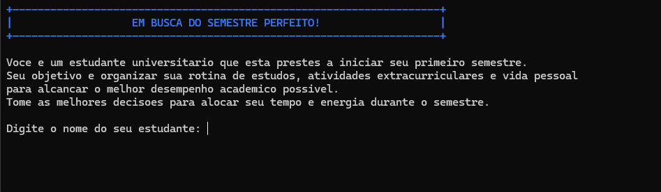

# Em Busca do Semestre Perfeito!

Um simples RPG de texto feito em C++ ambientado no primeiro semestre da graduação. O jogador assume o papel de um estudante e precisa tomar decisões ao longo das semanas para equilibrar **Energia** e **Conhecimento**, lidar com imprevistos do dia a dia universitário e alcançar o melhor encerramento possível. O jogo possuí 3 finais e 1 final secreto, boa sorte.

## Como Jogar

- **Atributos:**
  - **Energia:** cai com escolhas exaustivas e imprevistos; se chegar a `0%`, ocorre *Game Over* por **Burnout Acadêmico**.
  - **Conhecimento:** evolui conforme suas escolhas acadêmicas e de rotina.
A cada etapa/semana, leia o cenário, escolha uma das opções numéricas disponíveis e acompanhe o impacto nos seus status e no histórico da trajetória.

## Executar e Compilar
O executável já está presente, mas caso seja necessário basta, no terminal, digitar: "g++ main.cpp jogador.cpp NoEvento.cpp -o jogo", e, logo em seguida "./jogo.exe".
Vale ressaltar que todos os arquivos precisam estar na mesma pasta.

### ATENCAO 
Em alguns computadores houve um alerta na hora de executar o jogo por conta dele nao ter sido reconhecido, para resolver basta clicar em "Mais Detalhes" e "Executar mesmo assim".